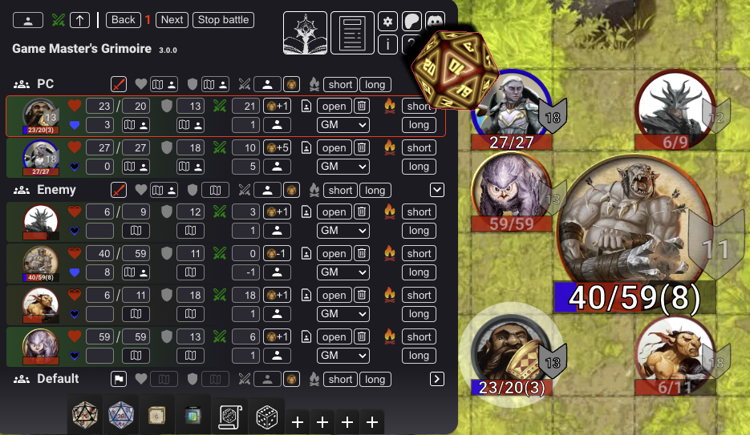

# Game Master's Grimoire - Owlbear Plugin

This Repository contains an Extension for Owlbear Rodeo 2.0. This extension allows for tracking HP of characters and handling who can view this information.

## Installing

The extension can be installed manually, by pasting the [manifest link](https://old.gmg.tabletop-almanac.com/manifest.json) in the Add Extension dialog.

This is the **previous** version of Game Master's Grimoire (3.7). The current version, Game Master's Grimoire 4, lives at [https://gmg.tabletop-almanac.com/manifest.json](https://gmg.tabletop-almanac.com/manifest.json). This old build runs on the frozen previous Tabletop Almanac backend and no longer receives updates or support; it stays available for as long as it keeps running.

## How it works

See [USAGE.md](https://raw.githubusercontent.com/kamejosh/owlbear-hp-tracker/master/USAGE.md)

## Building

Can be built with `make build`, for development use `make run`.

## License

MIT

## Contributing

I'm not sure how to handle contributions yet, Bug fixes are always welcome but features depend on backwards compatibility and maintaining a simple enough extension to use. But feel free to fork and open PRs.

Copyright (C) 2025 Joshua Hercher
